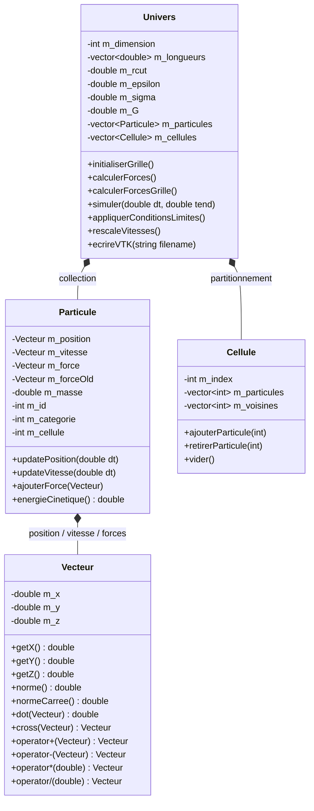

# Simulation de Particules — C++ pour les Mathématiques Appliquées

[](https://github.com/marwane-hajjy/ParticleSimulation/actions/workflows/ci.yml)
[](https://en.cppreference.com/w/cpp/17)
[](https://cmake.org/)
[](https://github.com/google/googletest)
[](https://valgrind.org/)
[](LICENSE)

**Grenoble INP - Ensimag**  
Filière MMIS (Modélisation Mathématique, Image et Simulation) — 2ème Année — Printemps 2026  
**Auteurs :** Marouane El Hadari (`elhadarm`), Marwane Hajjy (`hajjym`)

---

## Sommaire

1. [Présentation](#1-présentation)
2. [Modèles Physiques et Numériques](#2-modèles-physiques-et-numériques)
3. [Architecture Logicielle](#3-architecture-logicielle)
4. [Prérequis](#4-prérequis)
5. [Compilation et Installation](#5-compilation-et-installation)
6. [Suite de Tests](#6-suite-de-tests)
7. [Démonstrations et Simulations](#7-démonstrations-et-simulations)
8. [Visualisation avec ParaView](#8-visualisation-avec-paraview)
9. [Analyse de Performance et Mémoire](#9-analyse-de-performance-et-mémoire)
10. [Documentation Doxygen](#10-documentation-doxygen)
11. [Rapports par TP](#11-rapports-par-tp)
12. [Auteurs et Licence](#12-auteurs-et-licence)

---

## 1. Présentation

**ParticleSimulation** est une bibliothèque C++17 conçue pour la modélisation et la simulation numérique de systèmes particulaires discrets en interaction. Développée dans le cadre du cursus d'ingénieur à l'ENSIMAG, la bibliothèque propose une architecture orientée objet haute performance combinant rigueur algorithmique, gestion mémoire stricte et intégration numérique symplectique.

### Fonctionnalités principales

- **Intégrateur symplectique** : Algorithme de Störmer-Verlet (forme vitesse de Verlet) assurant la conservation de l'énergie et des invariants symplectiques sur de longs intervalles de temps.
- **Interactions physiques** :
  - Interaction gravitationnelle newtonienne ($N$-corps).
  - Potentiel moléculaire de Lennard-Jones 12-6 avec rayon de coupure ($r_{cut}$).
  - Champ gravitationnel externe uniforme.
- **Optimisation algorithmique** :
  - Découpage spatial par grille de cellules cartésiennes (*cell linked-lists* / décomposition de domaine), réduisant la complexité du calcul des forces à courte portée de $\mathcal{O}(N^2)$ à $\mathcal{O}(N)$.
  - Exploitation de la 3e loi de Newton ($\mathbf{F}_{ij} = -\mathbf{F}_{ji}$), divisant par deux le nombre d'évaluations d'interactions.
- **Conditions aux limites** :
  - Réflexion géométrique spéculaire.
  - Réflexion par potentiel répulsif aux parois (forces continues réalistes).
  - Conditions aux limites périodiques (topologie torique).
  - Absorption (suppression des particules franchissant les frontières).
- **Thermostat cinétique** : Rééchelonnement périodique des vitesses (*velocity rescaling*) pour le maintien de l'énergie cinétique cible.
- **Export standardisé** : Fichiers VTK XML Unstructured Grid (`.vtu`) pour rendu 3D et analyse temporelle dans ParaView.

---

## 2. Modèles Physiques et Numériques

### 2.1. Schéma d'intégration de Störmer-Verlet

Le schéma de Störmer-Verlet est un intégrateur symplectique d'ordre 2 en temps. Pour une particule $i$ de masse $m_i$ soumise à une force totale $\mathbf{F}_i$, la mise à jour des positions et vitesses s'écrit :

$$\mathbf{r}_i(t + \Delta t) = \mathbf{r}_i(t) + \mathbf{v}_i(t)\Delta t + \frac{\mathbf{F}_i(t)}{2m_i}\Delta t^2$$

$$\mathbf{v}_i(t + \Delta t) = \mathbf{v}_i(t) + \frac{\mathbf{F}_i(t) + \mathbf{F}_i(t + \Delta t)}{2m_i}\Delta t$$

Ce schéma préserve le volume de l'espace des phases (théorème de Liouville) et évite la dérive énergétique observée avec des intégrateurs non symplectiques comme Euler explicite.

### 2.2. Interaction gravitationnelle newtonienne

Pour deux corps ponctuels de masses $m_i$ et $m_j$ séparés par le vecteur $\mathbf{r}_{ij} = \mathbf{r}_j - \mathbf{r}_i$ :

$$\mathbf{F}_{ij} = G \frac{m_i m_j}{\|\mathbf{r}_{ij}\|^3} \mathbf{r}_{ij}$$

### 2.3. Potentiel de Lennard-Jones 12-6

Le potentiel interatomique de Lennard-Jones modélise la répulsion à courte portée (principe d'exclusion de Pauli) et l'attraction à moyenne portée (forces de dispersion de Van der Waals) :

$$V_{LJ}(r) = 4\varepsilon \left[ \left(\frac{\sigma}{r}\right)^{12} - \left(\frac{\sigma}{r}\right)^6 \right]$$

La force dérivée appliquée sur la particule $i$ par la particule $j$ s'écrit :

$$\mathbf{F}_{ij} = 24\varepsilon \frac{\mathbf{r}_{ij}}{r^2} \left[ 2\left(\frac{\sigma}{r}\right)^{12} - \left(\frac{\sigma}{r}\right)^6 \right], \quad \forall r < r_{cut}$$

La distance d'équilibre à force nulle correspond à $r_0 = 2^{1/6}\sigma \approx 1.12246\sigma$.

### 2.4. Découpage spatial par grille ($r_{cut}$)

Le domaine de simulation $\Omega = [0, L_1] \times [0, L_2] \times [0, L_3]$ est subdivisé en cellules cartésiennes cubiques de côté $c \ge r_{cut}$. Ainsi, chaque particule n'interagit qu'avec les particules appartenant à sa propre cellule ou aux cellules immédiatement voisines ($3^d$ cellules en dimension $d$). Pour une densité moyenne uniforme, le coût de calcul passe de $\mathcal{O}(N^2)$ à $\mathcal{O}(N)$.

### 2.5. Réflexion par potentiel aux parois

Pour éviter les discontinuités de vitesse associées à la réflexion spéculaire pure, les parois exercent une force répulsive progressive :

$$\mathbf{F}_{wall}(r) = -24\varepsilon \frac{1}{2r} \left(\frac{\sigma}{2r}\right)^6 \left[1 - 2\left(\frac{\sigma}{2r}\right)^6\right] \mathbf{n}, \quad \text{pour } r < 2^{1/6}\sigma$$

où $r$ est la distance orthogonale à la paroi et $\mathbf{n}$ la normale sortante.

---

## 3. Architecture Logicielle

### Arborescence du dépôt

```
TP_elhadarm_hajjym/
├── include/              # Interfaces publiques C++ (.hxx)
│   ├── Vecteur.hxx       # Vecteur 3D et algèbre linéaire
│   ├── Particule.hxx     # Particule (état dynamique, masse, identifiant)
│   ├── Cellule.hxx       # Cellule du maillage spatial
│   └── Univers.hxx       # Moteur de simulation, intégrateur et I/O
├── src/                  # Implémentations (.cxx, bibliothèque 'particules')
│   ├── Vecteur.cxx
│   ├── Particule.cxx
│   ├── Cellule.cxx
│   ├── Univers.cxx
│   └── CMakeLists.txt
├── demo/                 # Programmes de démonstration
│   ├── demo_tp1_trace.cxx
│   ├── demo_tp1_euler.cxx
│   ├── demo_tp2_solar.cxx
│   ├── demo_tp3_collections.cxx
│   ├── demo_tp4_collision.cxx
│   ├── demo_tp6_boundary.cxx
│   └── CMakeLists.txt
├── test/                 # Suite de tests GoogleTest
│   ├── test_vecteur.cxx
│   ├── test_particule.cxx
│   ├── test_univers.cxx
│   ├── test_boundary.cxx
│   └── CMakeLists.txt
├── doc/                  # Spécifications Doxygen et analyse UML
│   ├── doxyfilerc
│   ├── analyse.txt
│   └── CMakeLists.txt
├── rapports/             # Rapports détaillés par étape (TP1 à TP6)
│   ├── rapport_tp1.md
│   ├── rapport_tp2.md
│   ├── rapport_tp3.md
│   ├── rapport_tp4.md
│   ├── rapport_tp5.md
│   └── rapport_tp6.md
├── scripts/              # Outils d'automatisation
│   ├── build.sh
│   ├── run_all_demos.sh
│   └── check_memory.sh
├── .github/              # Intégration continue et modèles GitHub
│   ├── workflows/
│   │   ├── ci.yml
│   │   └── documentation.yml
│   ├── ISSUE_TEMPLATE/
│   │   ├── bug_report.md
│   │   └── feature_request.md
│   └── PULL_REQUEST_TEMPLATE.md
├── CMakeLists.txt        # Configuration racine CMake
├── Makefile              # Raccourcis pour les développeurs
├── .clang-format         # Normes de formatage C++
├── .gitignore            # Règles d'exclusion Git
├── .gitattributes        # Normalisation des fins de ligne
├── CONTRIBUTING.md       # Guide de contribution
├── CHANGELOG.md          # Journal des versions
├── SECURITY.md           # Politique de sécurité
├── CITATION.cff          # Métadonnées de citation académique
└── LICENSE               # Licence MIT
```

### Diagramme de classes (UML)



---

## 4. Prérequis

### Configuration requise

| Composant | Version minimale | Rôle |
| :--- | :--- | :--- |
| **Compilateur C++** | GCC 9.0+ ou Clang 10.0+ | Support strict de C++17 |
| **CMake** | 3.16.3+ | Générateur de système de build |
| **Make** ou **Ninja** | Récent | Moteur d'exécution de compilation |
| **Git** | 2.25+ | Gestionnaire de versions |

### Outils optionnels recommandés

- **ParaView** (5.8+) : Visualisation et rendu volumique des maillages non structurés `.vtu`.
- **Valgrind** (3.15+) : Analyse de mémoire dynamique et détection des fuites.
- **Doxygen** (1.9+) & **Graphviz** : Génération de la documentation HTML et des graphes d'héritage.
- **clang-format** (14.0+) : Vérification de conformité du style de code.

---

## 5. Compilation et Installation

### Compilation standard (Release)

```bash
cmake -B build -DCMAKE_BUILD_TYPE=Release
cmake --build build -j$(nproc)
```

Ou en utilisant le raccourci :

```bash
make build
```

### Options de configuration CMake

| Option | Défaut | Description |
| :--- | :--- | :--- |
| `BUILD_DEMOS` | `ON` | Active la compilation des simulations de démonstration |
| `BUILD_TESTING` | `ON` | Active la compilation des tests unitaires GoogleTest |
| `BUILD_DOCS` | `ON` | Active la cible de génération Doxygen (`make doc`) |
| `ENABLE_PROFILING` | `OFF` | Active les indicateurs de profiling `-pg` pour gprof |

Exemple avec options spécifiques :

```bash
cmake -B build \
    -DCMAKE_BUILD_TYPE=Debug \
    -DBUILD_DEMOS=ON \
    -DBUILD_TESTING=ON \
    -DBUILD_DOCS=OFF
```

---

## 6. Suite de Tests

La suite de tests unitaires repose sur **GoogleTest** (intégré via `FetchContent` de CMake) et couvre l'ensemble des modules :

- **VecteurTest** (17 tests) : Constructeurs, arithmétique, produit vectoriel, produit scalaire, exceptions de division par zéro, opérateurs de comparaison.
- **ParticuleTest** (10 tests) : Unicité des identifiants, mise à jour Störmer-Verlet, gestion des forces, calcul de l'énergie cinétique.
- **UniversTest** (10 tests) : Ajout de particules, détection des dimensions invalides, calcul des forces gravitationnelles et Lennard-Jones, initialisation de grille, génération de fichiers VTK.
- **BoundaryTest** (6 tests) : Réflexion géométrique, absorption, conditions périodiques (positives et négatives), rééchelonnement des vitesses (*rescaling*).

### Lancement des tests

```bash
ctest --test-dir build --output-on-failure
```

Ou via le `Makefile` :

```bash
make test
```

Résultat attendu :

```
100% tests passed, 0 tests failed out of 43
Total Test time (real) = ~0.20 sec
```

---

## 7. Démonstrations et Simulations

Le répertoire `demo/` propose 6 programmes illustrant les concepts physiques et numériques abordés :

| Démonstration | Description | Sortie générée |
| :--- | :--- | :--- |
| `demo_tp1_trace` | Calcul et débogage de trace matricielle 2D dynamique | Affichage console |
| `demo_tp1_euler` | Analyse de convergence et stabilité d'EDO (Euler explicite vs implicite) | Affichage console |
| `demo_tp2_solar` | Trajectoires orbitales du système solaire (Soleil, Terre, Lune, comète) | `solar_*.vtu` |
| `demo_tp3_collections` | Benchmark comparatif des conteneurs STL et mesure de complexité $\mathcal{O}(N^2)$ | Affichage console |
| `demo_tp4_collision` | Collision moléculaire 2D (carré contre rectangle) avec grille spatiale | `collision_tp4_*.vtu` |
| `demo_tp6_boundary` | Écoulement sous gravité avec paroi à potentiel répulsif et thermostat | `boundary_tp6_*.vtu` |

### Exécuter une démonstration individuelle

```bash
cd build
./demo/demo_tp2_solar
```

### Exécuter l'ensemble des démonstrations

Le script `scripts/run_all_demos.sh` isole les fichiers de sortie `.vtu` dans `build/outputs/` :

```bash
make run-demos
# ou
./scripts/run_all_demos.sh
```

---

## 8. Visualisation avec ParaView

Les simulations génèrent des fichiers `.vtu` (format XML pour maillages non structurés VTK).

### Protocole de visualisation

1. Lancer **ParaView** :
   ```bash
   paraview
   ```
2. **Ouvrir la séquence temporelle** :
   - Menu `File` $\rightarrow$ `Open`.
   - Sélectionner le groupe de fichiers (ex. `collision_tp4_..vtu` ou `solar_..vtu`).
   - Cliquer sur le bouton **Apply**.
3. **Représenter les particules en 3D (Glyphs)** :
   - Dans le menu supérieur, appliquer le filtre : `Filters` $\rightarrow$ `Common` $\rightarrow$ `Glyph`.
   - Paramétrer le filtre :
     - **Glyph Type** : `Sphere`
     - **Scale Array** : `No scale array` (ou choisir un rayon fixe dans `Scale Factor`, ex. `0.5`)
     - **Masking** : `All Points`
   - Cliquer sur **Apply**.
4. **Coloration** :
   - Sélectionner la variable scalaire à afficher : `Vitesse` (magnitude) ou `Categorie`.
5. **Animation** :
   - Utiliser les commandes de lecture temporelle (`Play`, `Loop`) pour observer l'évolution dynamique.

---

## 9. Analyse de Performance et Mémoire

### 9.1. Complexité algorithmique

L'évaluation des interactions à courte portée sans grille requiert $N(N-1)/2$ calculs de paires, soit une complexité temporelle en $\mathcal{O}(N^2)$. Grâce à la décomposition en cellules cartésiennes (`Cellule`) de taille $c \ge r_{cut}$, seules les paires distantes de moins de $r_{cut}$ sont explorées, ramenant la complexité à $\mathcal{O}(N)$.

| Nombre de particules ($N$) | Méthode directe $\mathcal{O}(N^2)$ | Grille spatiale $\mathcal{O}(N)$ |
| :---: | :---: | :---: |
| 512 | 0.0024 s | < 0.001 s |
| 4 096 | 0.1619 s | 0.008 s |
| 32 768 | 11.18 s | 0.065 s |

### 9.2. Vérification mémoire avec Valgrind

La gestion mémoire de la bibliothèque fait l'objet d'un contrôle strict :

```bash
make valgrind
# ou
./scripts/check_memory.sh
```

Résultat pour l'ensemble des tests unitaires :
```
All heap blocks were freed -- no leaks are possible
ERROR SUMMARY: 0 errors from 0 contexts
```

---

## 10. Documentation Doxygen

Pour générer la documentation complète de l'API au format HTML :

```bash
make doc
```

Ouvrir ensuite `build/doc/html/index.html` dans un navigateur Web :

```bash
xdg-open build/doc/html/index.html 2>/dev/null || open build/doc/html/index.html
```

---

## 11. Rapports par TP

Chaque étape du travail pratique fait l'objet d'un rapport méthodologique détaillé dans le dossier [`rapports/`](rapports/) :

- [`rapport_tp1.md`](rapports/rapport_tp1.md) : Débogage mémoire (trace matricielle) et stabilité des schémas d'intégration pour EDO raides.
- [`rapport_tp2.md`](rapports/rapport_tp2.md) : Modèle objet `Particule`, algorithme de Störmer-Verlet et simulation gravitationnelle du système solaire.
- [`rapport_tp3.md`](rapports/rapport_tp3.md) : Surcharge des opérateurs de `Vecteur`, classe `Univers`, benchmark des conteneurs STL et optimisation Newtonienne $\mathbf{F}_{ij} = -\mathbf{F}_{ji}$.
- [`rapport_tp4.md`](rapports/rapport_tp4.md) : Potentiel de Lennard-Jones, découpage spatial par cellules et simulation de collision 2D.
- [`rapport_tp5.md`](rapports/rapport_tp5.md) : Conception logicielle, diagrammes UML (cas d'utilisation, séquence, classes), tests GoogleTest et format VTK.
- [`rapport_tp6.md`](rapports/rapport_tp6.md) : Conditions aux limites avancées (réflexion géométrique vs potentiel de paroi), champ de pesanteur externe et thermostat cinétique.

---

## 12. Auteurs et Licence

### Auteurs

- **Marouane El Hadari** — Grenoble INP - Ensimag (`elhadarm`)
- **Marwane Hajjy** — Grenoble INP - Ensimag (`hajjym`)

### Licence

Ce projet est distribué sous les termes de la licence **MIT**. Consulter le fichier [LICENSE](LICENSE) pour plus de détails.
